<p align="center">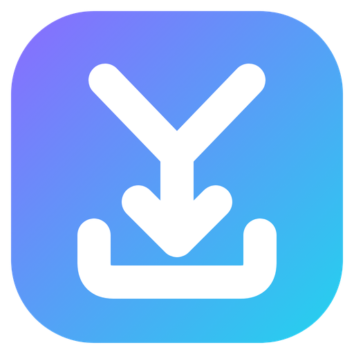</p>

<h1 align="center">Yoinks</h1>

<p align="center">
Paste a link, pick a quality, get the file.<br>
Videos and music from YouTube, TikTok, SoundCloud, Instagram and 1,800+ other sites, on Windows, Linux, Android and in your browser.
</p>

<p align="center">
<a href="https://github.com/bliper2/yoinks-gui-fork/releases/latest"></a>
<a href="https://github.com/bliper2/yoinks-gui-fork/releases"></a>
<a href="LICENSE"></a>
<a href="https://discord.gg/knRghkqzct"></a>
</p>

<p align="center">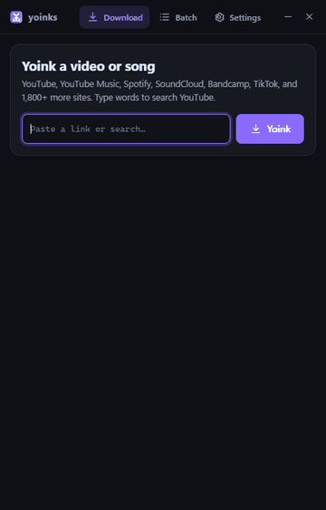</p>

Yoinks runs [yt-dlp](https://github.com/yt-dlp/yt-dlp) for the downloading and [ffmpeg](https://ffmpeg.org) for the converting. It comes as a **desktop app** (Windows and Linux), a **browser extension** (Brave, Chrome, Edge, Firefox) and a native **Android app**. The desktop app and the extension share one engine, one settings file and one UI. No ads, no tracking, no accounts.

It is built on [yoinks](https://github.com/pablostanley/yoinks) by Pablo Stanley.

## Download

Get the file for your system from the [latest release](https://github.com/bliper2/yoinks-gui-fork/releases/latest).

| You use | Get | Notes |
|---|---|---|
| Windows | `Yoinks-<version>-x64-setup.exe` | Installer. Updates itself and sets up the browser helper. |
| Windows, no install | `Yoinks-<version>-x64-portable.exe` | Just run it. Also on Scoop (below). |
| Linux | `Yoinks-<version>-linux-x86_64.AppImage` | `chmod +x` it and run it. Updates itself. |
| Debian, Ubuntu | `Yoinks-<version>-linux-amd64.deb` | |
| Fedora, openSUSE | `Yoinks-<version>-linux-x86_64.rpm` | |
| Android | `Yoinks-android-<version>-arm64-v8a.apk` | Almost every phone from the last 8 years. |
| Android, old phone | `Yoinks-android-<version>-armeabi-v7a.apk` | 32-bit phones. |
| Android, unsure | `Yoinks-android-<version>-universal.apk` | Works on any phone, but is bigger. |
| Brave, Chrome, Edge | `Yoinks-extension-<version>.zip` | See [Browser extension](#browser-extension). |
| Firefox 140+, Waterfox | `Yoinks-extension-<version>.xpi` | See [Browser extension](#browser-extension). |

**Windows:** the builds are not code-signed yet, so SmartScreen may warn on first run. Click **More info**, then **Run anyway**.

**Android:** allow "Install unknown apps" for your browser or file manager the first time. Since 2.6.1 the APKs are signed with one permanent key and install as `com.yoinks.app`, so later updates install over them. If you have an older debug build (`com.yoinks.app.debug`), install the new one by hand once, then remove the old one. More in [android/README.md](android/README.md#install-on-a-phone).

**Scoop (Windows):**

```
scoop install https://raw.githubusercontent.com/bliper2/yoinks-gui-fork/main/packaging/scoop/yoinks.json
```

What changed in each version is in [CHANGELOG.md](CHANGELOG.md). The apps also show it once after an update.

## What it does

**Download**

- Paste a link and pick a format, or type words to search YouTube.
- Playlists: tick the videos you want before downloading.
- Batch: paste many links, or drop a `.txt` file, and queue them all.
- Clips: download part of a video, with sliders when the length is known.
- Spotify links: Yoinks never downloads from Spotify. It reads the public title, artist, album and cover, finds each song on YouTube Music, and shows every match with a confidence score. You can pick another result or skip a song.
- Presets: save a combination such as "Music FLAC" and pick it with one click. The format list can also remember a quality for each website.
- Convert files on your computer to MP3, M4A, FLAC, Opus or MP4 (Windows and Linux).

**Queue**

- Pause, resume, retry and cancel. Set how many downloads run at once.
- Automatic retries for network errors, and notifications when a download finishes or fails.
- A download window ("only between 01:00 and 07:00") on Windows, Linux and Android. Android can also wait on low battery or Data Saver.
- Sort files into folders by uploader or website, and split videos with chapters.
- Unfinished downloads come back paused after a restart, on every platform.
- Search your recent downloads and download any of them again with the same quality.
- Windows and Linux: progress on the taskbar icon, and an optional tray icon that keeps downloads going with the window closed.

**In your browser**

- A Yoink button on YouTube, YouTube Music, SoundCloud, Bandcamp, TikTok, Instagram, X, Vimeo, Twitch, Spotify, Reddit, Facebook, Dailymotion, Streamable and Rumble pages. Its menu has best video, 1080p, 720p, MP3, a clip from the current position, the whole playlist and "Choose format".
- Right-click a link for **Yoink link** or **Yoink link as audio**, or a page for **Yoink this page as audio** and **Yoink all videos on this page**.
- **Alt+Y** opens Yoinks. The toolbar badge shows progress.

**On Android**

- Share a link from TikTok, YouTube, Instagram, Snapchat, Spotify or any app to Yoinks. yt-dlp and ffmpeg run on the phone.
- A Quick Settings tile that yoinks the link you copied, and a "Paste link" shortcut.
- Pictures and a Share button in the finished notification, and search in Settings.

**Help when it breaks**

- Settings has a health check for yt-dlp, ffmpeg, your folders, storage and connection.
- Errors are written in plain words, with a **Copy details** button for Discord or a GitHub issue.
- yt-dlp updates itself, and once more right away when a site stops working.

**Looks**

- Four styles (Clean, Playful, Neon, Classic), light, dark or system, five accent colors and a custom one. The navigation can sit at the top or float at the bottom. Android has the same styles.

Everything is configurable on one settings page: download folder, file name template with a live preview, audio format and bitrate, tags, cover art, subtitles, speed limit, retries, browser cookies for age-restricted videos, SponsorBlock to cut sponsored parts out of YouTube videos, a proxy for videos blocked in your country, export and import as JSON.

## Screenshots

**Desktop app** (the extension's popup is the same UI)

<p>
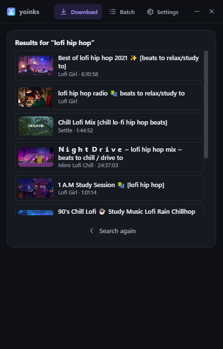
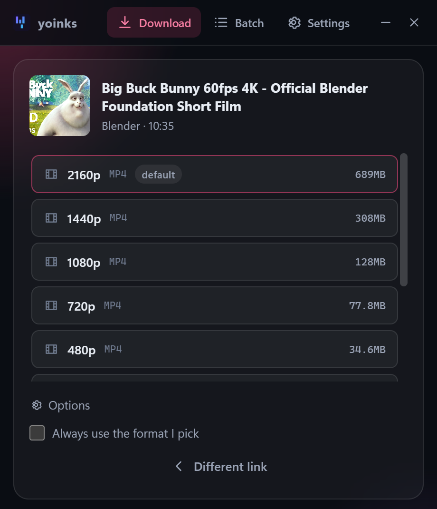
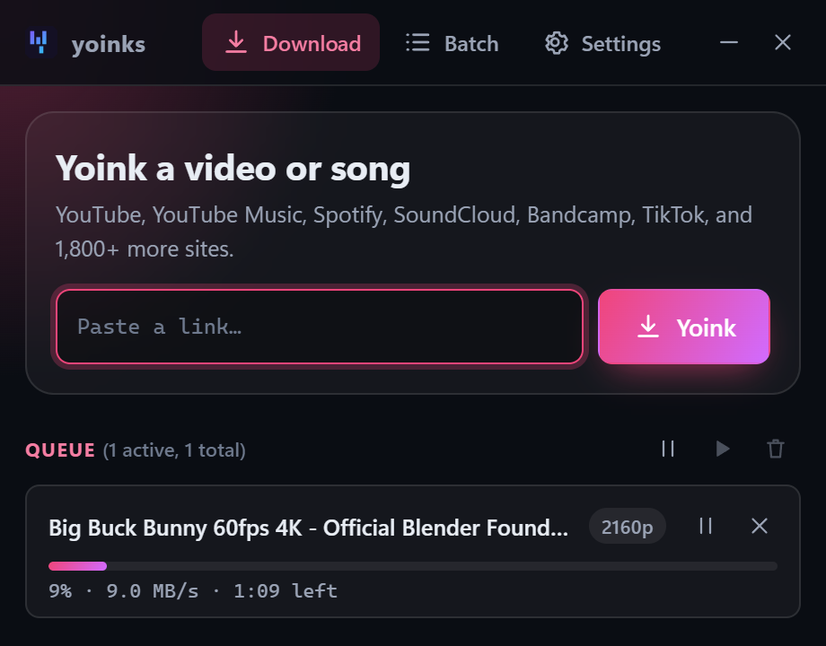
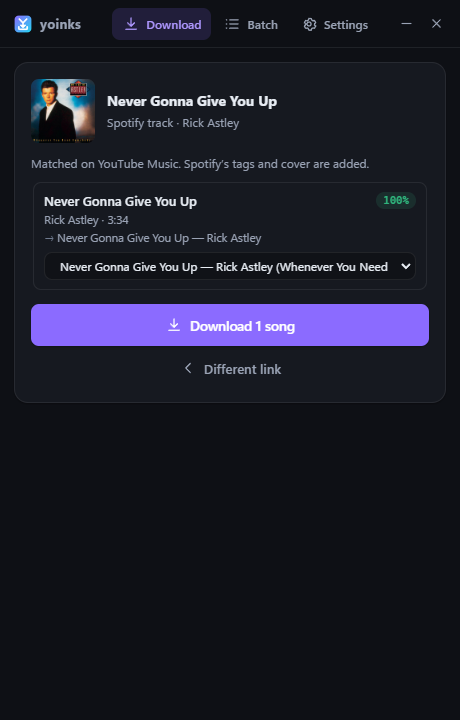
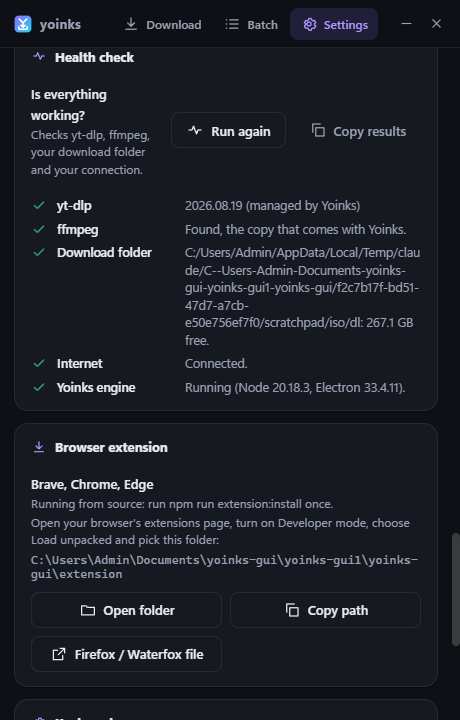
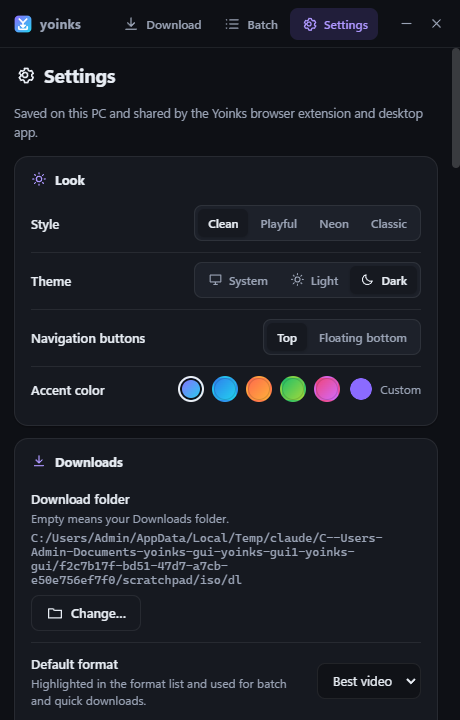
</p>

**Styles** (Settings, Look, Style)

<p>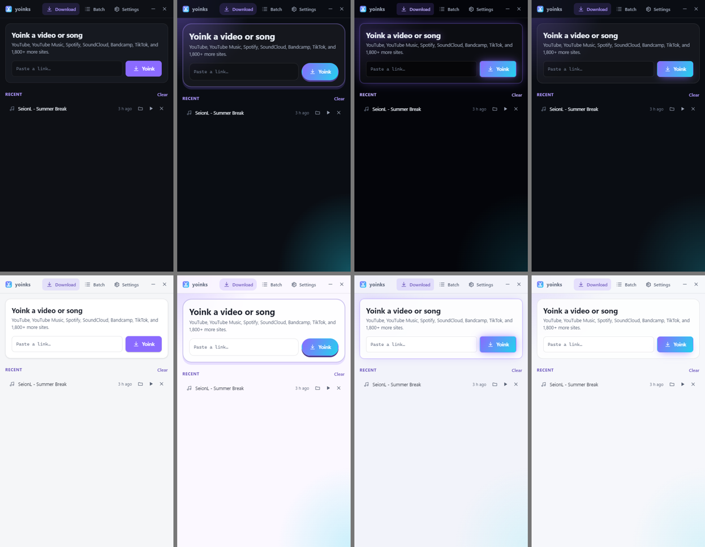</p>

**Floating navigation** (Settings, Look, Navigation buttons)

<p>
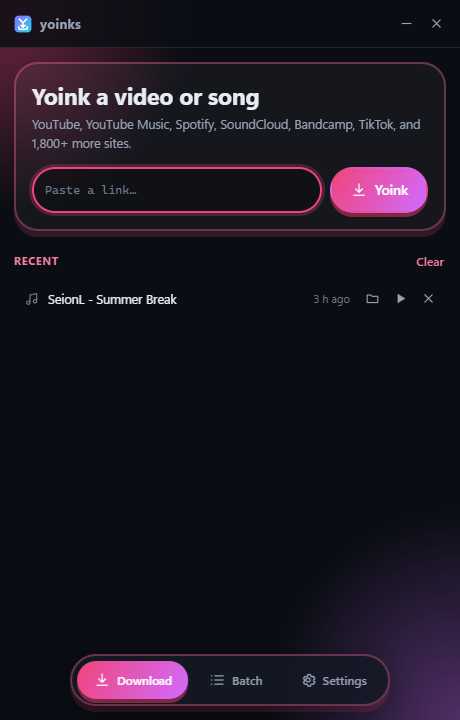
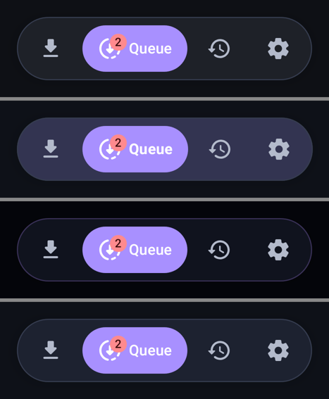
</p>

**Browser extension**

<p>
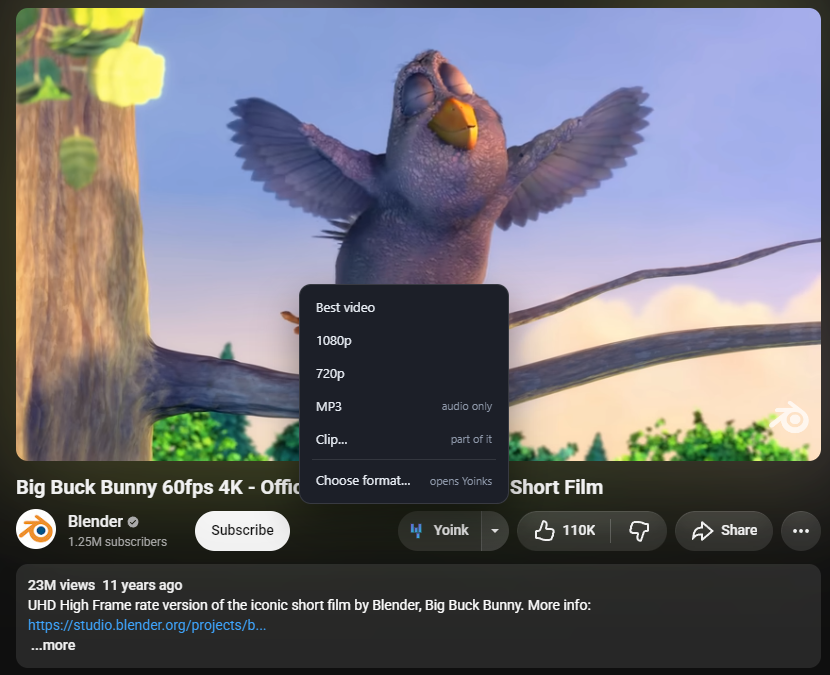
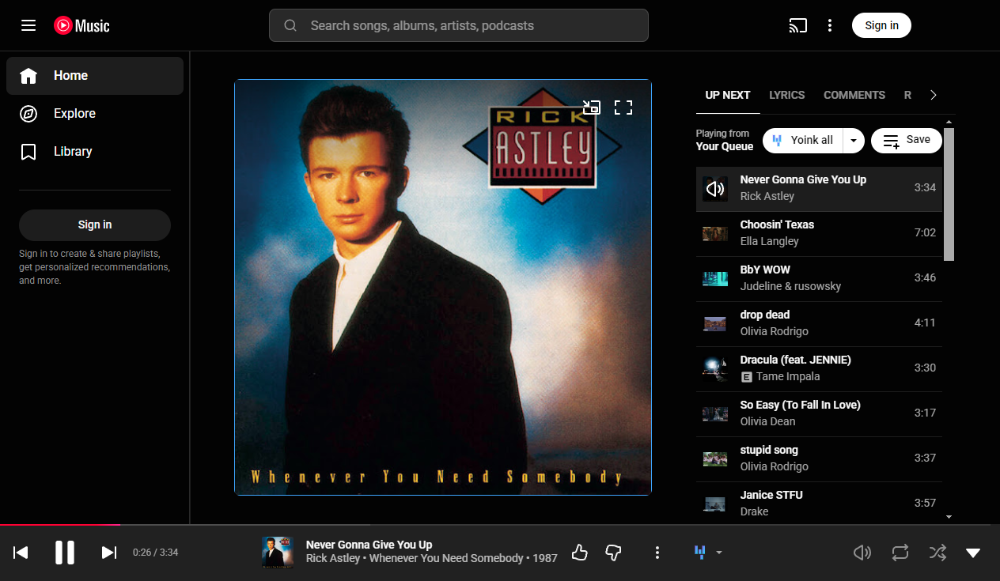
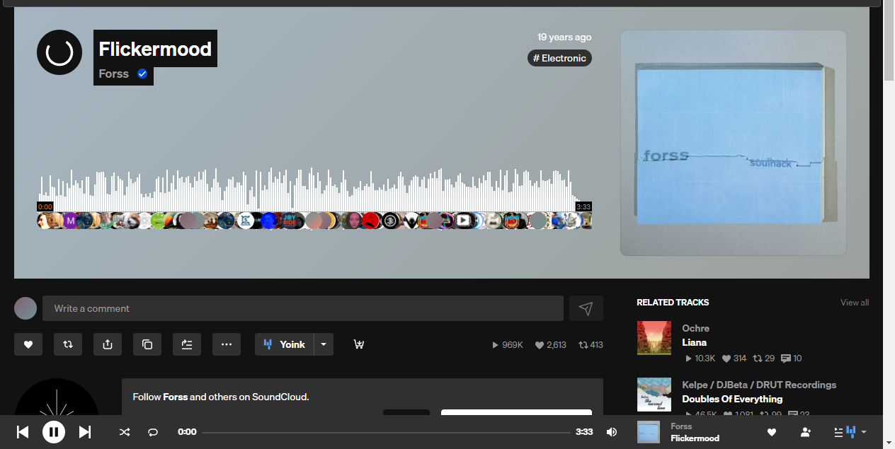
</p>

**Android**

<p>
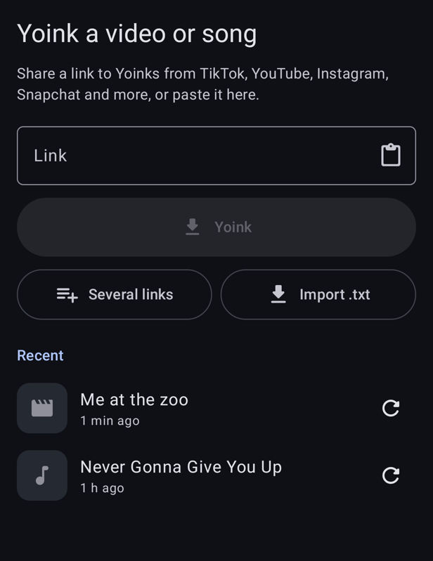
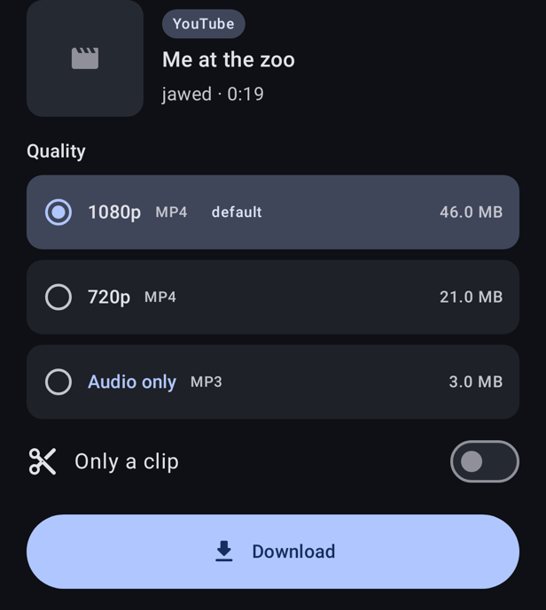
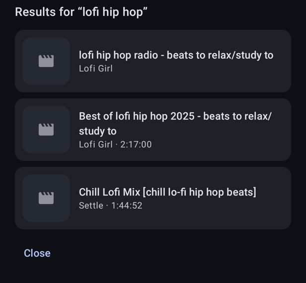
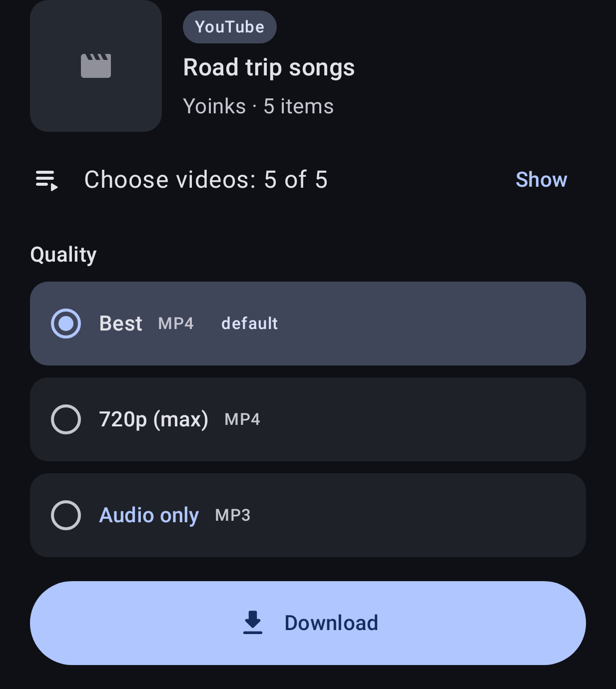
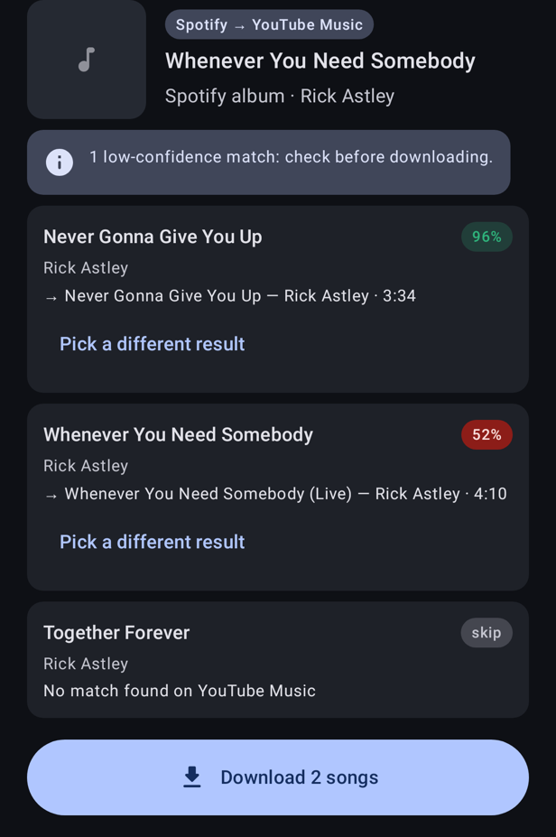
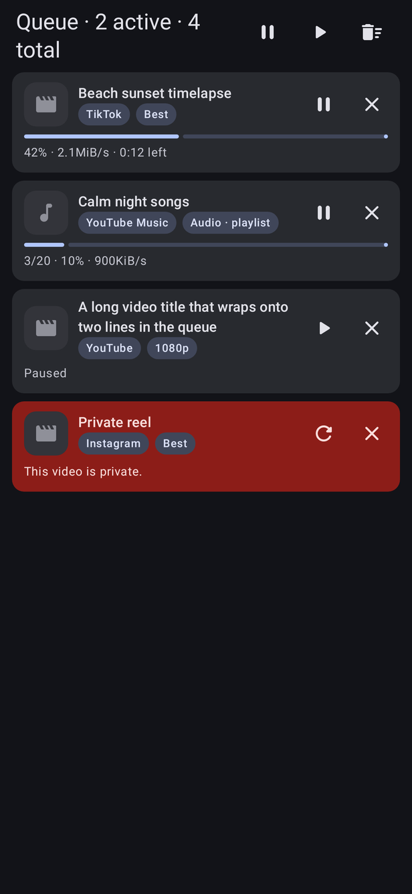
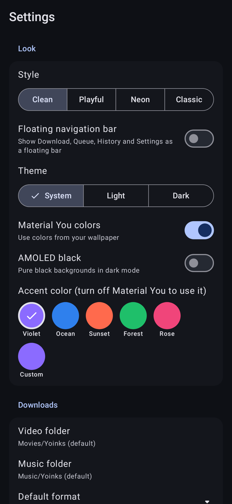
</p>

## Browser extension

Browsers cannot run yt-dlp, so the extension talks to a small helper that runs the same engine as the desktop app. The browser starts it when needed. The desktop app does not have to be open.

**With the installed Windows or Linux app (no Node.js needed)**

1. Install and start Yoinks once. It sets up the helper for Chrome, Edge, Brave, Firefox and Waterfox on its own.
2. Open Settings, **Browser extension**. It shows the extension folder, with **Open folder** and **Copy path** buttons.
3. Open `brave://extensions` (or `chrome://extensions`, `edge://extensions`), turn on **Developer mode**, click **Load unpacked** and pick that folder.
4. Restart the browser once. A Terms page opens on first install: accept it.

**With the portable app, or the zip from Releases (Node.js 18 or newer)**

1. Unzip it, run `npm install`, then `npm run extension:install`.
2. Load the `extension/` folder as in steps 3 and 4 above.

**Firefox and Waterfox:** open `Yoinks-extension-<version>.xpi` with Waterfox and click **Add**. Release Firefox only installs Mozilla-signed add-ons, so use `about:debugging`, **Load Temporary Add-on** and pick `extension/manifest.json`, or Firefox Developer Edition or Nightly with `xpinstall.signatures.required` set to `false`. Snap and Flatpak browsers cannot use the helper.

Unpacked extensions do not update themselves. To update, download the new zip (or `.xpi`) and click reload on the extension card.

## Android app

A native app (Kotlin, Jetpack Compose) in [`android/`](android). Build and install steps are in [android/README.md](android/README.md). It is licensed GPL-3.0 because it bundles youtubedl-android ([android/LICENSE](android/LICENSE)).

## Build from source

```
npm install
npm start
```

Needs Node.js 18 or newer. Building installers, the project layout, tests and how a release is made are in [docs/DEVELOPMENT.md](docs/DEVELOPMENT.md).

## Help

- **Discord:** [Yoink Community](https://discord.gg/knRghkqzct) for help, update news and ideas.
- **Bugs and feature requests:** [open an issue](https://github.com/bliper2/yoinks-gui-fork/issues/new/choose). Say which app you use (Windows, Linux, extension or Android), its version and the link that failed. **Copy details** on the error does most of that for you.
- **Common problems:** [docs/KNOWN-ISSUES.md](docs/KNOWN-ISSUES.md).
- **Security problems:** see [SECURITY.md](SECURITY.md) and report them privately.

## Fair use

Yoinks is a tool for keeping your own copies. Downloading can break a site's terms of service, so only download what you have the right to keep. See [extension/legal/terms.md](extension/legal/terms.md).

## License and credits

The desktop app and the extension are MIT ([LICENSE](LICENSE)). The Android app is GPL-3.0. Built on [pablostanley/yoinks](https://github.com/pablostanley/yoinks) (MIT), and powered by [yt-dlp](https://github.com/yt-dlp/yt-dlp) (Unlicense) and [FFmpeg](https://ffmpeg.org) (LGPL/GPL).
